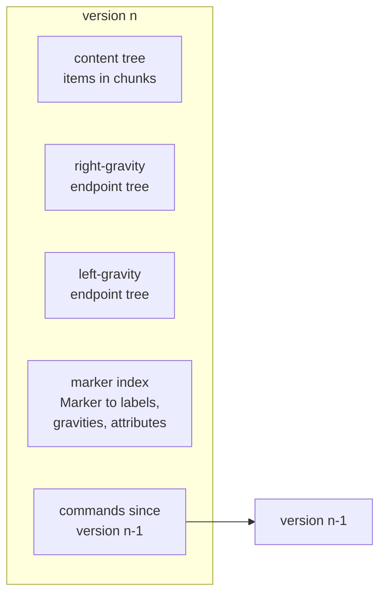
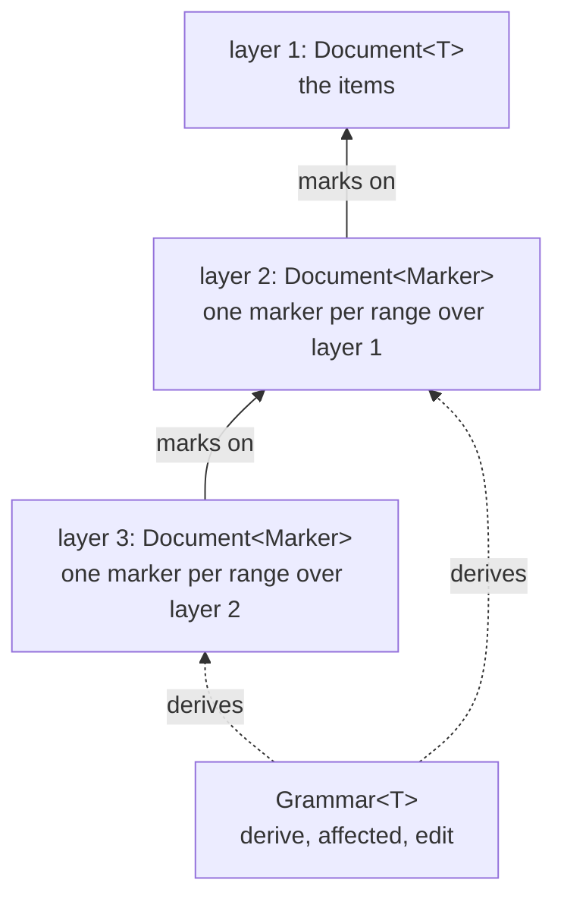
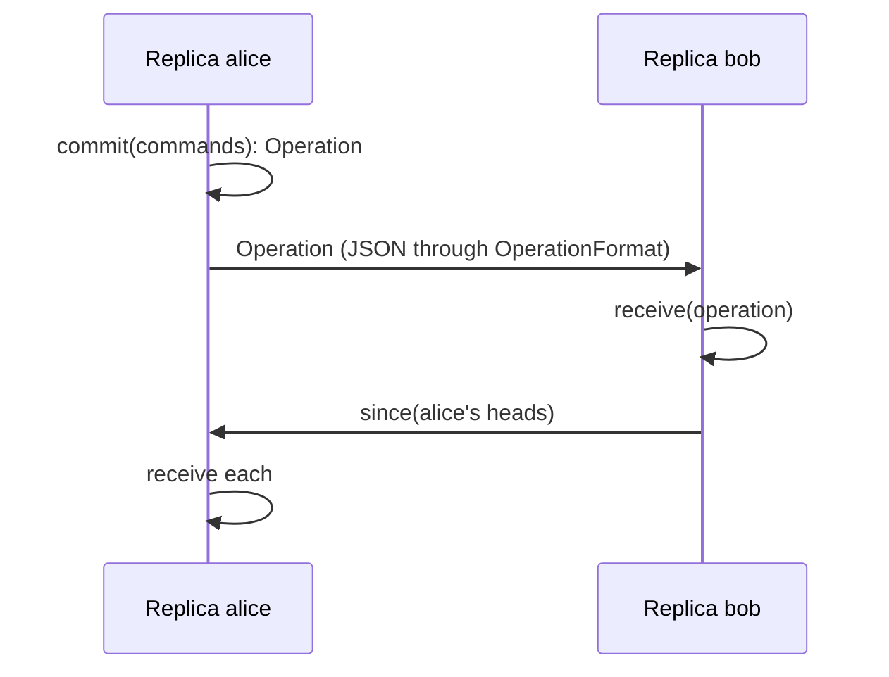

# Architecture

libara is one Dart library, `package:libara/libara.dart`, built from ten
modules under `lib/src/`. It is pure Dart with one runtime dependency,
`package:characters`, and runs on the VM and the web. This page describes
the modules, how they depend on each other, the conventions they share,
and the main data structures at the level of their parts. How each part
works is in [algorithms.md](algorithms.md).

## Modules

```mermaid
graph BT
  sequence
  range --> sequence
  attributed --> range
  constructor --> attributed
  persistent --> attributed
  format --> persistent
  coordinate --> constructor
  coordinate --> persistent
  layered --> format
  replica --> format
  selector --> layered
```

An arrow points from a module to one it imports. Every module also
imports the ones below its targets; the graph shows the direct
dependencies that matter. Nothing imports upwards, and there are no
cycles.

| Module | Purpose | Main public types |
|---|---|---|
| `sequence` | the SEQUENCE type of Core Range Algebra, and `Result` | `Sequence`, `Items`, `Text`, `Result`, `Success`, `Failure`, `Kind` |
| `range` | the RANGE type and sequences of ranges | `Range`, `Ranges` |
| `attributed` | attributed ranges and their values | `ARange`, `Attribute`, `Value`, `Str`, `Num`, `Bool`, `Nil` |
| `constructor` | range constructors and their composition | `Constructor`, `regex`, `union`, `concat`, `layer` |
| `persistent` | the versioned, editable document | `Document`, `Command` and its cases, `Marker`, `Gravity`, `edits` |
| `format` | saving and loading | `Format`, `JSONFormat`, `Limits`, `text` |
| `coordinate` | editor coordinates and grapheme clusters | `Coordinates`, `Unit`, `Place`, `Columns`, `snapped` |
| `layered` | layers of ranges over ranges | `Layered`, `Grammar`, `Derived`, `Derivation`, `Edit`, `Change`, `Delta`, `LayeredFormat` |
| `selector` | CSS-like queries | `Selector`, `Scope` |
| `replica` | peer-to-peer replication | `Replica`, `Operation`, `Stamp`, `Key`, `OperationFormat` |

The first four modules are the papers' algebra, over immutable values.
`persistent` makes the algebra editable. The rest are built on a document:
`format` saves it, `coordinate` measures it, `layered` stacks documents,
`selector` queries them, and `replica` shares one between peers.

`lib/libara.dart` exports every module and hides what is internal:
`Hierarchy` and the unchecked `extent` from `range`, the content tree's
measures from `persistent`, the projection helpers from `layered`, the
shared command reader and writer from `format`, and `Clock` from
`replica`. Within the package, modules reach these through their `src`
paths.

## Shared conventions

### Failures are values

Every operation that can fail in an expected way returns a
`Result<T>`: a `Success` with the value, or a `Failure` with a `Kind`
(`bounds`, `missing`, `invalid`, `syntax`, `runtime`) and a message.
`map`, `flatMap`, `fold`, and `or` compose them. A chain that can fail is
`Result` from end to end; nothing unwraps and throws in the middle.

Code a caller plugs in is caught at its boundary. A `Grammar`'s methods
and an item `Format` run inside a guard that turns an exception into a `Failure` of kind `invalid`,
or, while a layered document is first built, into a diagnostic. Only two
things throw: a `TypeError` from storing a wrong item into a covariant
sequence, as Dart's `List` does, and an exception from a callback passed
to `Result.map` or `flatMap`.

### Immutability and persistence

Every value is immutable. Sequences, ranges, attributes, commands,
documents, layered documents, and replicas all return a new value from
every change. The persistent structures share everything a change does
not touch, so an old version costs only the nodes that differ from the
new one, and keeping history is cheap.

### Determinism

Results never depend on hash order, timing, or randomness. Sorts are
stable, ties are broken by original position, and treap priorities come
from a hashed counter with a fixed seed, so the same operations build
trees of the same shape on every run, on the VM and on the web.

### Extension points

A caller extends the library at five boundaries, each a small interface:

| Boundary | Interface | Contract |
|---|---|---|
| items | `Sequence<T>` | immutable; getters do not throw |
| ranges | `Range` subclass | `start` and `length` never change or fail |
| finding ranges | `Constructor<T>` | a pure function from a sequence to `Result<Ranges>` |
| layer meaning | `Grammar<T>` | pure: answers depend only on its arguments |
| serialisation | `Format<D, S>` | `decode(encode(x))` equals `x`, apart from what it documents |

These are trusted. `JSONFormat` bounds what it reads with `Limits`, but
nothing bounds what plugged-in code does.

## The document

A `Document<T>` is the centre of the library. One version is four
persistent trees and a link to the version before it:



- The **content tree** holds the items.
- Two **endpoint trees** hold the start and end of every marked range, one
  tree for each gravity. An endpoint stores its position relative to its
  parent node, so one change at a subtree's root moves every endpoint in
  it. Each endpoint also carries a **label**, a stable key in endpoint
  order that edits never change.
- The **marker index** maps each `Marker` to the labels of its two
  endpoints, their gravities, and the range's attributes.
- The **log** is the list of commands that made this version, so `map`
  can carry a position forward, and the saved history can be replayed.

A `Marker` is an identity created with a `Mark` command, so the caller
holds it before the command is applied. `resolve(marker)` finds the
labels in the index, then the positions in the endpoint trees, and builds
the `ARange`. Every query (`at`, `overlapping`, `within`, `crossing`,
`markers`) reads the endpoint trees and resolves what it finds.

Commands are a sealed hierarchy: `Insert`, `Delete`, `Replace` edit the
items; `Mark`, `Unmark`, `Update` edit the ranges. `apply` makes one new
version, `transact` makes one version from many commands, and
`apply(flatten: true)` coalesces a command into the current version.

`Document<T>` is itself a `Sequence<T>`, so constructors, selectors, and
coordinates take it wherever they take a sequence.

## The layered document



A `Layered<T>` keeps layers 1 to n. Layer 1 is a `Document<T>` of the
items. Each layer k above it is a `Document<Marker>`: its items are the
markers of ranges marked on layer k - 1's document, in start order. So a
range at layer k indexes the items of layer k - 1, and an edit to layer
k - 1 moves it without any offset being rewritten. Diagnostics are also
marks on layer k - 1, kept in a set beside the layer instead of in its
items, each with a `message` attribute.

The caller's `Grammar<T>` gives the layers meaning:

- `depth`, read once;
- `derive(document, layer, region)`, the ranges and diagnostics of a layer
  over a region of the layer below;
- `affected(document, layer, changed)`, the region an edit touches;
- `edit(document, change)`, for an `Edit` above layer 1, a `Derivation`
  that carries it out as edits one layer down, or a `Failure` that refuses
  it.

An `Edit(layer, command)` reuses the document commands. `apply` and
`transact` return a `Change`: the new version and, per layer, a `Delta`
of ranges created, removed, and updated, and the regions derived again.
`LayeredFormat` saves only layer 1, since the grammar rebuilds the rest.

The layered module is split by job: `layered.dart` holds the class, its
queries, and the edit entry points; `region.dart` computes regions;
`reconcile.dart` derives a layer again and matches the result to what
was there; `settle.dart` carries out structural edits; `delta.dart` merges
and maps deltas; `projection.dart` projects ranges down to layer 1.

## Selectors

A selector is parsed once into an immutable syntax tree and evaluated over
a list of keyed ranges, `List<(K, ARange)>`. Any source of such a list can
be queried: a document's `markers`, one layer of a layered document, or
`Layered.across`, which projects several layers to layer-1 positions so
one selector relates them. A `Scope` indexes a list once (its containment
hierarchy and key positions) for many selections. Evaluation works on
whole sets of ranges at a time, never one range against the tree.

## Replicas



A `Replica<T>` wraps a `Document<T>` with what replication needs: a
hybrid logical clock, every operation it holds keyed by stamp, a
checkpoint of its state after each, a `History` of every item ever
inserted in Fugue order, and a two-way map between its local markers and
the `Key`s that name ranges on every replica. `commit` applies commands
locally and returns the `Operation` to send; `receive` merges one from
any peer; `since` lists what a peer lacks. The replica holds no network
code and no queue: transport, retry of operations whose parents have not
arrived, and retry of stamps too far ahead are the caller's.

## Coordinates

`Coordinates` converts between code-point positions and what editors
count: UTF-16 offsets, lines, and columns in units, code points, or
grapheme clusters. Over a `Document<int>` it reads measures that the
content tree's nodes cache, so it shares structure with the document and
costs `O(log n)` per query in any version.

## Tests and checks

The tests mirror the modules under `test/`, with model-based tests that
compare the persistent structures to simple reference models, property
and convergence tests for replicas, and benchmark and scale suites run on
demand. `test/readme_test.dart` checks that the README example is
`example/example.dart` and prints what the README says, and
`test/music_test.dart` does the same for the music example.

`tool/check.sh` runs what every change must pass, and CI runs it on every
push: analysis with infos fatal, formatting, the tests on the VM with at
least 95% line coverage of `lib/src`, the tests under Chrome, and the
`dart doc` build with no warnings.
